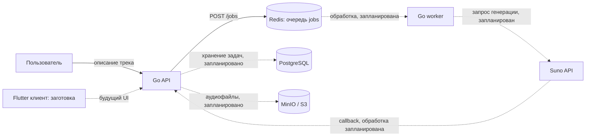
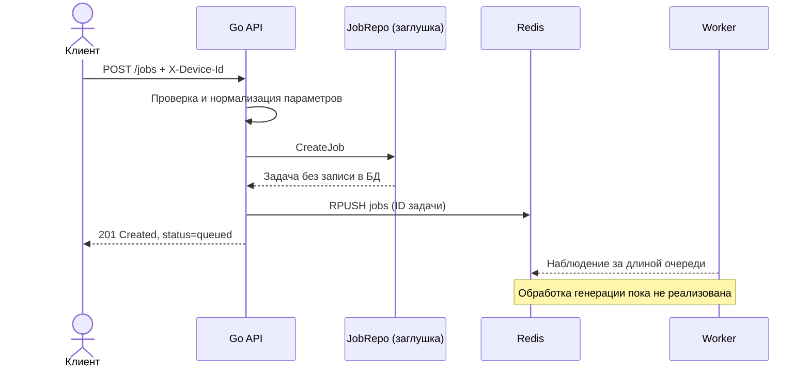

# AI Music Generator

Командный проект по генерации музыкальных треков из текстового описания. В репозитории собраны Go API, очередь задач на Redis, локальная инфраструктура на Docker Compose и контракт будущего приложения. Проект разрабатывался командой **AI-Music-App001**; эта копия размещена в личном профиле участника команды.

> **Статус:** прототип. Сейчас API принимает запрос на генерацию и помещает идентификатор задачи в Redis. Полный цикл создания и выдачи готового трека пока не реализован.

## Идея и сценарий

Пользователь описывает желаемую композицию: настроение, стиль, вокал или инструментальный формат. Сервис создаёт задачу, передаёт её в фоновую обработку и после ответа генератора должен сохранить треки и показать их в библиотеке пользователя.



**Сплошные стрелки** показывают уже подключённый путь запроса. **Пунктирные** — намеченные интеграции. PostgreSQL и MinIO запускаются локально, но сохранение задач и файлов к ним пока не подключено.

## Что есть в коде

| Компонент | Текущее состояние |
| --- | --- |
| Go API | `GET /health`, `GET /ready`, `POST /jobs`, `POST /suno/callback` |
| Создание задачи | Проверка параметров, UUID устройства в `X-Device-Id`, ответ `201`, постановка ID задачи в Redis |
| Redis | Реальная очередь задач; worker пока выводит её состояние в лог, но не забирает задачи |
| PostgreSQL | Поднимается через Compose и проверяется в `/ready`; репозиторий задач пока заглушка без записи в БД |
| Suno callback | Проверяет секрет и формат запроса; сохранение результата ещё отмечено как TODO |
| MinIO | Локальное S3-хранилище с bucket `tracks`; загрузка аудио ещё не подключена |
| Flutter | Структура мобильного клиента и зависимости; экранов и запускаемого приложения пока нет |
| OpenAPI | Контракт целевого API; часть описанных методов ещё не реализована |

### Путь запроса сейчас



## Технологии

Go 1.22 · Redis 7 · PostgreSQL 16 · MinIO · Nginx · Docker Compose · Flutter (заготовка) · OpenAPI / Swagger UI.

## Локальный запуск

Нужны Docker и Docker Compose. Из корня репозитория:

```bash
cp .env.example .env
docker compose -f infra/docker-compose.yml up --build
```

Проверка:

```bash
curl http://localhost:8080/health
curl http://localhost:8080/ready
```

Ожидаемые ответы: `ok` и `ready`. Если порты уже заняты, измените `API_HOST_PORT` и `NGINX_HOST_PORT` в `.env`; порты PostgreSQL, Redis и MinIO сейчас заданы в Compose напрямую.

| Сервис | Адрес |
| --- | --- |
| API | http://localhost:8080 |
| Nginx → API | http://localhost:8088 |
| Swagger UI | http://localhost:8081 |
| MinIO Console | http://localhost:9001 |

Пример создания задачи:

```bash
curl -X POST http://localhost:8080/jobs \
  -H 'Content-Type: application/json' \
  -H 'X-Device-Id: 123e4567-e89b-42d3-a456-426614174000' \
  -d '{"prompt":"Спокойная электронная музыка для вечерней прогулки","custom_mode":false,"instrumental":true}'
```

Ответ содержит ID и статус `queued`. **Готовый трек этот запрос пока не создаёт:** worker не обрабатывает очередь. Значения в `.env.example` предназначены только для локального запуска; для реального окружения задайте собственные пароли и секреты.

Остановка:

```bash
docker compose -f infra/docker-compose.yml down
```

## Структура репозитория

```text
apps/mobile_flutter/     заготовка мобильного клиента
services/cmd/api/        точка входа HTTP API
services/cmd/worker/     точка входа worker
services/internal/       доменная модель, обработчики, очередь и порты
infra/                   Dockerfile и Compose
nginx/                   reverse proxy
docs/                    OpenAPI, архитектурные и технические заметки
```

## Что дальше

1. Реализовать хранение задач и треков в PostgreSQL.
2. Научить worker забирать задачи из Redis и отправлять запросы на генерацию.
3. Обрабатывать callback от Suno, сохранять аудио в MinIO и обновлять статус задачи.
4. Реализовать чтение задач, библиотеку треков и мобильные экраны.
5. Синхронизировать OpenAPI-контракт с фактически доступными маршрутами.

Дополнительные материалы: [локальный запуск](docs/dockerGuide.md), [контракт API](docs/openapi1.yml), [целевая структура](docs/targetArchitecture.md), [исходная архитектурная идея](docs/startingArchitecture.md).
